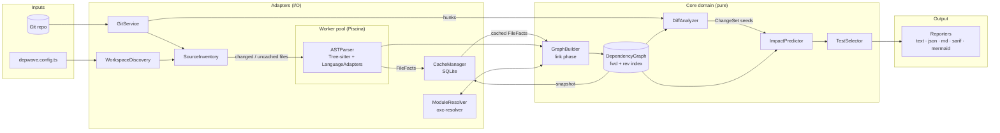
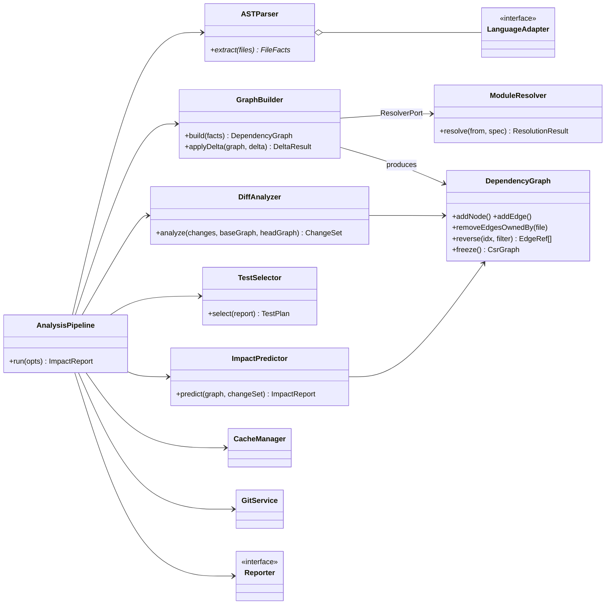
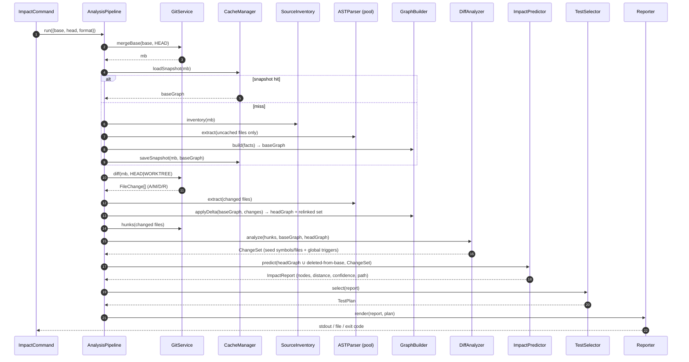

# Depwave — AST-Driven Monorepo Dependency & Impact Analyzer

> **Name:** `depwave` (CLI: `depwave`): a change sends a wave through the dependency graph; depwave measures how far it travels.
> **One-liner:** Given a git diff, tell me exactly which symbols, packages, and tests are affected, and *why*, in under 2 seconds on a warm cache.

---

## 0. Design Principles

| Principle | What it means in practice |
|---|---|
| **Soundness over precision** | A missed test (false negative) costs far more than an extra test (false positive). When analysis is uncertain, widen the blast radius; never shrink it. |
| **Pure core, impure edges** | Graph model, algorithms, and impact logic have zero I/O. Git, FS, SQLite, and Tree-sitter sit behind ports (hexagonal architecture). |
| **Everything is a cacheable pure function** | `facts = parse(content, parserVersion)`. If inputs are the same, the output is reused. This is what makes incremental mode possible. |
| **Explainable output** | Every impacted node carries the shortest path that reached it (`depwave why`). A tool that can't explain itself won't be trusted in CI. |
| **Incremental == full rebuild** | That equivalence is enforced with property-based tests. It is the most important invariant in the system. |

---

## 1. Tech Stack & Tooling Selection

### 1.1 Final choices

| Concern | Choice | Runner-up(s) | Why |
|---|---|---|---|
| **Implementation language** | **TypeScript (Node 22 LTS)** | Rust, Go | The target domain (JS/TS monorepos) lives in the Node ecosystem, which brings a native resolver, test runners, and contributors. CPU hot paths (parse, resolve) are already native via Tree-sitter and oxc. A Rust core via `napi-rs` stays possible if profiling demands it. |
| **Parser** | **Tree-sitter** via `web-tree-sitter` (WASM): no native build anywhere (ADR 0001) | Babel, TS Compiler API, oxc-parser, native per-language ASTs, native `tree-sitter` bindings | See 1.2. |
| **Type-aware precision mode** (optional, Phase 3) | **TypeScript Compiler API** (`ts.LanguageService`) | ts-morph | Only for call-edge resolution that requires types (method calls on interfaces). Opt-in because it's 10–50× slower. |
| **Module resolution** | **Own resolver over a git-backed virtual FS**, with **`oxc-resolver` as a differential test oracle** (ADR 0005) | `oxc-resolver` at runtime, `enhanced-resolve` | Needs complete probe lists (including missing paths) for cache invalidation, and must resolve commits that aren't checked out. oxc's JS API can't do either: no custom FS, no dependency report. The oracle keeps our algorithm honest. |
| **Graph store** | **Custom `DependencyGraph`** (interned integer IDs, forward + reverse adjacency, per-file edge ownership) | graphology, ngraph | Incremental updates need "remove all edges *owned by* file X" in O(edges of X). Generic libraries don't model ownership, and their object-per-edge overhead hurts at 1M+ edges. A **graphology adapter** is kept for export/visualization only. |
| **Cache engine** | **SQLite** via `better-sqlite3` (WAL mode) | LMDB, RocksDB, JSON files, Redis | One portable file that's easy to `actions/cache` in CI. It's transactional, so a crashed run can't corrupt state. It's queryable for debugging (`sqlite3 .depwave/cache.db`). Synchronous API means no async overhead on hot lookups. |
| **Content hashing** | **Git blob OIDs everywhere**: `ls-tree` for commits, index OIDs for clean files, and one batched `git hash-object --stdin-paths` for dirty/untracked ones | xxh3, blake3, sha256 | Git hands you a content hash for every clean file *for free*, so a cold start hashes almost nothing. One hash function means a file's cache key is identical whether it's read from a commit or the working tree. |
| **Parallelism** | `worker_threads` pool via **Piscina** | child processes | Parsing is CPU-bound and embarrassingly parallel per file. ⚠️ Verify that the native Tree-sitter addon is worker-safe in your pinned version; fall back to WASM in workers if not. |
| **CLI framework** | **Clipanion** | commander, oclif, yargs | Commands are classes with typed options. They are unit-testable without spawning a process. Used by Yarn Berry. Lighter than oclif. |
| **Config validation** | **Zod** | ajv | One schema gives both the TS types and the runtime validation. |
| **Git access** | Spawn `git` directly (`-z` NUL-delimited output) | simple-git, isomorphic-git | Full fidelity (`--find-renames`, `merge-base`, `cat-file --batch`) and zero abstraction leaks. isomorphic-git is slow on large repos. |
| **Testing** | **Vitest** + **fast-check** (property-based) + fixture monorepos | Jest | Fast, ESM-native. fast-check powers the incremental-equivalence tests. |
| **Tool's own repo** | pnpm workspaces + Turborepo + Changesets | Nx | Standard, minimal. The tool *dogfoods itself* on its own repo in CI. |

### 1.2 Parser decision: Tree-sitter vs Babel vs native ASTs

| Criterion | Tree-sitter | Babel | Native ASTs (tsc, `ast` in Python, `go/parser`) |
|---|---|---|---|
| Multi-language | ✅ One API, 100+ grammars | ❌ JS/TS only | ❌ One runtime per language |
| Speed | ✅ C, ~1–5 ms/file | ⚠️ Slower, JS-based | Varies |
| Error tolerance (half-written code) | ✅ Produces a tree with `ERROR` nodes | ⚠️ `errorRecovery` is partial | ⚠️ Often fails hard |
| Declarative extraction | ✅ `.scm` query language | ❌ Imperative visitors | ❌ Imperative |
| Incremental re-parse | ✅ Built-in `tree.edit()` | ❌ | ❌ |
| Semantic/type info | ❌ Syntax only | ❌ | ✅ (tsc) |

**Decision:** Tree-sitter is the primary parser. Language support becomes *data* (query files + a small adapter) rather than *code*. The lack of semantics is covered by a separate resolution phase (`oxc-resolver`) and, optionally, the TS Compiler API precision mode. Babel buys nothing that Tree-sitter plus oxc doesn't, and it locks you into JS.

---

## 2. System Architecture & Core Data Structures

### 2.1 High-level architecture



**Layering rule (enforced in CI with `dependency-cruiser`):** `core` imports nothing from `adapters`. Adapters implement interfaces that `core` defines.

### 2.2 Two-phase model: Facts → Graph

This split is what makes incremental analysis tractable.

1. **Extract (per file, embarrassingly parallel, cacheable):** `FileFacts = f(content, language, parserVersion)`. This produces no cross-file knowledge.
2. **Link (global, cheap):** resolve import specifiers to files, bind imported names to exported symbols, and emit edges.

### 2.3 Node schema

```ts
type NodeId = string; // stable, human-readable, e.g. "sym:packages/ui/src/Button.tsx#Button"
type NodeKind = 'package' | 'file' | 'symbol' | 'test' | 'external' | 'unresolved';
type SymbolKind = 'function' | 'class' | 'method' | 'variable' | 'type' | 'interface' | 'enum' | 'component';

interface BaseNode {
  id: NodeId;
  kind: NodeKind;
  idx: number;            // interned dense integer, used by traversal (never persisted as identity)
}

interface PackageNode extends BaseNode {
  kind: 'package';
  name: string;           // "@acme/ui"
  root: string;           // "packages/ui"
  manifestHash: string;   // hash of package.json (deps changes = global-ish invalidation)
}

interface FileNode extends BaseNode {
  kind: 'file';
  path: string;           // repo-relative, POSIX separators
  packageId: NodeId;
  language: LanguageId;   // 'typescript' | 'tsx' | 'javascript' | 'python' | ...
  contentHash: string;    // git blob OID (hash-object for dirty/untracked files)
  isTest: boolean;
  hasSideEffects: boolean; // top-level statements beyond declarations/imports
}

interface SymbolNode extends BaseNode {
  kind: 'symbol';
  fileId: NodeId;
  name: string;           // "Button", "UserService.save"
  symbolKind: SymbolKind;
  exported: boolean | 'default';
  span: { startLine: number; endLine: number; startByte: number; endByte: number };
  bodyHash: string;       // hash of the symbol's normalized text (whitespace/comments stripped)
}

interface TestNode extends BaseNode {
  kind: 'test';
  fileId: NodeId;
  framework: 'vitest' | 'jest' | 'pytest' | 'playwright' | 'unknown';
  name?: string;          // describe/it title (Phase 3: per-test-case selection)
}

interface ExternalNode extends BaseNode { kind: 'external'; specifier: string; version?: string } // "react@18.3.1"
interface UnresolvedNode extends BaseNode { kind: 'unresolved'; reason: UnresolvedReason; raw: string }
```

### 2.4 Edge schema

```ts
type EdgeKind =
  | 'CONTAINS'         // package→file, file→symbol, class→method
  | 'IMPORTS'          // file→file (module-level)
  | 'IMPORTS_SYMBOL'   // file→symbol (named/default import, after re-export chasing)
  | 'RE_EXPORTS'       // file→symbol|file (barrel files: export * / export { x } from)
  | 'CALLS'            // symbol→symbol
  | 'REFERENCES'       // symbol→symbol (non-call usage: extends, JSX <Button/>, type refs)
  | 'DYNAMIC_IMPORT'   // file→file|glob (import(), require(expr), lazy())
  | 'DEPENDS_ON'       // package→package|external (from package.json)
  | 'TESTS';           // test→file|symbol (derived: test file's transitive imports)

type Confidence = 'certain' | 'likely' | 'heuristic';

interface Edge {
  from: number;               // node idx
  to: number;                 // node idx
  kind: EdgeKind;
  confidence: Confidence;
  ownerFile: number;          // ⭐ file whose contents produced this edge (the key to incremental invalidation)
  typeOnly?: boolean;         // `import type` — excluded from runtime impact by default, included for type-check impact
  loc?: { line: number; col: number };
  meta?: { pattern?: string; viaReExport?: number[] }; // e.g. glob for import(`./locales/${l}.json`)
}
```

**How dynamic references are handled:**

| Source pattern | Edge | Confidence |
|---|---|---|
| `import x from './a'` | `IMPORTS` + `IMPORTS_SYMBOL` | certain |
| `import('./pages/' + name)` / template literal with a static prefix | `DYNAMIC_IMPORT` to every file matching glob `./pages/*` | likely |
| `require(someVar)` / `import(name)` (fully dynamic) | `DYNAMIC_IMPORT` → `UnresolvedNode`, plus a **wildcard dependency** on the importer's package | heuristic. Under `conservative`, the importing file is treated as depending on *every file in its package*, so any change there impacts it (see §4.4). |
| `obj[methodName]()` | `CALLS` → all methods of `obj`'s class if known, else a file-level fallback | heuristic |
| Framework conventions (Next.js `app/**/page.tsx`, DI containers) | Emitted by **plugins** (Phase 3) | likely |

### 2.5 In-memory graph layout

```ts
class DependencyGraph {
  private nodes: Node[];                         // indexed by idx
  private idByKey: Map<NodeId, number>;          // interning
  private out: Array<EdgeRef[]>;                 // forward adjacency
  private in:  Array<EdgeRef[]>;                 // ⭐ reverse adjacency (impact traversal walks this)
  private ownedEdges: Map<number /*file*/, Set<EdgeRef>>; // incremental removal in O(|edges of file|)
  private tombstones: Uint8Array;                // lazy deletion; compact when >20% dead
}
```

For CI-scale traversal there's an optional `freeze()` that produces a **CSR (compressed sparse row)** reverse index of `Int32Array`s. That's cache-friendly, zero-GC, and roughly 10× smaller.

---

## 3. Class & Module Design

### 3.1 Repository layout

```text
depwave/
├── packages/
│   ├── core/                     # PURE domain: no fs, no git, no sqlite
│   │   ├── src/model/            # Node, Edge, FileFacts, ChangeSet, ImpactReport types
│   │   ├── src/graph/            # DependencyGraph, GraphSnapshot, CSR freeze
│   │   ├── src/algorithms/       # reverseBfs, tarjanScc, topoSort, shortestPath
│   │   ├── src/build/            # GraphBuilder (link phase), ReExportResolver
│   │   ├── src/diff/             # DiffAnalyzer (hunks→symbols)
│   │   ├── src/impact/           # ImpactPredictor, policies, scoring
│   │   ├── src/tests/            # TestSelector
│   │   └── src/ports/            # ⭐ interfaces implemented by adapters
│   ├── parser/
│   │   ├── src/ASTParser.ts      # worker-pool facade
│   │   ├── src/treeSitter.ts     # WASM runtime + grammar loading
│   │   ├── src/worker.ts         # runs inside Piscina (later)
│   │   └── src/languages/
│   │       ├── typescript/{TypeScriptAdapter.ts, extract.ts}   # two-pass walk (ADR 0001)
│   │       └── python/...
│   ├── resolver/                 # ModuleResolver (oxc-resolver + probe tracking)
│   ├── cache/                    # CacheManager (SQLite), migrations/
│   ├── git/                      # GitService
│   ├── workspace/                # WorkspaceDiscovery (pnpm/yarn/npm/nx/turbo), SourceInventory
│   ├── reporters/                # text, json, markdown (PR comment), sarif, mermaid, dot
│   ├── cli/                      # Clipanion commands + composition root
│   └── github-action/            # thin wrapper over cli
├── fixtures/                     # small realistic monorepos used as golden tests
│   ├── pnpm-basic/  barrel-hell/  ts-paths/  cycles/  dynamic-imports/  python-mixed/
├── bench/                        # synthetic 10k/50k-file repo generator + benchmarks
├── docs/adr/                     # Architecture Decision Records (0001-tree-sitter.md, ...)
└── depwave.config.ts              # dogfooding config
```

### 3.2 Ports (interfaces in `core/src/ports`)

```ts
export interface GitPort {
  mergeBase(a: string, b: string): Promise<string>;
  diff(base: string, head: string | 'WORKTREE'): Promise<FileChange[]>;   // name-status + rename detection
  hunks(base: string, head: string | 'WORKTREE', path: string): Promise<Hunk[]>;
  listTracked(rev: string): Promise<Array<{ path: string; oid: string }>>;
  readBlob(rev: string, path: string): Promise<string>;
}

export interface ParserPort {
  extract(files: SourceFile[]): AsyncIterable<FileFacts>;
  readonly version: string;           // part of every cache key
}

export interface ResolverPort {
  resolve(fromFile: string, specifier: string): ResolutionResult; // includes `probed: string[]`
}

export interface CachePort {
  getFacts(contentHash: string, lang: LanguageId, parserVersion: string): FileFacts | undefined;
  putFacts(facts: FileFacts[]): void;
  getResolution(fromDir: string, specifier: string, configHash: string): ResolutionResult | undefined;
  invalidateResolutionsProbing(paths: string[]): number;
  loadSnapshot(commit: string): GraphSnapshot | undefined;
  saveSnapshot(commit: string, graph: GraphSnapshot): void;
}

export interface LanguageAdapter {
  readonly id: LanguageId;
  readonly extensions: string[];
  readonly grammar: unknown;           // Tree-sitter Language
  extractFacts(tree: SyntaxTree, source: string, path: string): FileFacts;
  isTestFile(path: string): boolean;
}
```

### 3.3 Key classes and their single responsibilities

| Class | Package | Responsibility (one thing) | Depends on |
|---|---|---|---|
| `WorkspaceDiscovery` | workspace | Find packages and their roots/manifests from pnpm/yarn/npm/nx/turbo config **at any revision**, reading manifests through git in one batch. | GitPort |
| `SourceInventory` | workspace | Produce `SourceFile[]` (path, language, git OID, owning package) for a revision from one git listing. No filesystem walk. | GitPort, WorkspacePort |
| `LanguageRegistry` | parser | Map extension → `LanguageAdapter`. | — |
| `ASTParser` | parser | Turn source files into `FileFacts` via a worker pool. Knows nothing about other files. | LanguageRegistry, Piscina |
| `ModuleResolver` | resolver | Turn `(fromFile, specifier)` into target file / external / unresolved at one revision, recording **probed paths**. | VirtualFileSystem (from GitPort), Workspace |
| `CacheManager` | cache | Persist and retrieve facts, resolutions, and snapshots. Owns schema migrations. | better-sqlite3 |
| `GraphBuilder` | core | Link `FileFacts` into nodes/edges. Supports `build()` (full) and `applyDelta()` (incremental). | ResolverPort |
| `ReExportResolver` | core | Follow `export * from` / `export {x} from` chains so imports bind to the *defining* symbol, not the barrel. | DependencyGraph |
| `DependencyGraph` | core | Store nodes/edges with forward/reverse indexes and per-file ownership. | — |
| `GitService` | git | Implement `GitPort` by spawning `git`. | child_process |
| `DiffAnalyzer` | core | Map diff hunks to a `ChangeSet` of changed symbols/files (old and new side). | DependencyGraph, FileFacts |
| `ImpactPredictor` | core | Run seeded reverse traversal with edge filters, policies, and scoring, producing an `ImpactReport`. | DependencyGraph, ImpactPolicy |
| `ImpactPolicy` | core | Decide global invalidation rules (lockfile, tsconfig, env), confidence handling, depth limits. | config |
| `TestSelector` | core | Project an `ImpactReport` onto test nodes, grouped by package/runner. Emits runner-specific args. | — |
| `AnalysisPipeline` | cli | **Composition root.** Wires adapters into core and orchestrates a run. The only place `new` is called on adapters. | everything |
| `Reporter` (interface) | reporters | Render an `ImpactReport` into one output format. | — |

### 3.4 Class relationships



### 3.5 Execution sequence: `depwave impact --base origin/main`



---

## 4. Incremental Graph Caching & Algorithmic Strategy

### 4.1 Three cache layers, three different invalidation rules

| Layer | Key | Invalidated by | Why it's correct |
|---|---|---|---|
| **L1: FileFacts** | `(contentHash, languageId, parserVersion)` | Nothing. It's content-addressed and immutable. GC by LRU. | Facts are a pure function of content. Renames are free (same OID, so same facts). Branch switches are free. |
| **L2: Resolutions** | `(fromDir, specifier, resolverConfigHash)` + stored `probed[]` | (a) any `tsconfig`/`package.json` in scope changes, which changes `resolverConfigHash`; (b) a file is **added/deleted** at a path in some entry's `probed[]` | Resolution depends on what *doesn't* exist. Adding `utils.ts` next to `utils/index.ts` changes what `./utils` resolves to, even though no importing file changed. Tracking negative probes catches this. Most tools get it wrong. |

> **Measured (2026-10-27): L2 is stored and tested but not wired in.** Our resolver runs over an in-memory virtual FS at ~4.1 µs per import; an L2 SQLite hit costs ~5.9 µs *before* any staleness check. Probe tracking still matters: it is what makes resolution results trustworthy, and it is what a disk-backed resolver (or a long-running daemon) would key on. L1 + L3 deliver the speed-up.
| **L3: Graph snapshots** | `commitSha` (+ config hash) | Never: commits are immutable. Evicted oldest first beyond a 64 MB budget (the newest two always stay) and rebuilt from L1 when needed again. | Lets CI start from the merge-base graph instead of a cold build. Snapshots are stored gzipped inside SQLite. |

### 4.2 `applyDelta` algorithm (git diff → updated graph)

```text
input: baseGraph, changes = [{status: A|M|D|R, path, oldPath?}]

1. RENAMES (R, same OID):  re-key file node + its symbols; edges unchanged. Mark importers for re-resolution.
2. DELETES (D):            removeEdgesOwnedBy(file); tombstone file + symbol nodes;
                           invalidateResolutionsProbing([path]) → collect affected importers.
3. ADDS (A):               invalidateResolutionsProbing([path]) → collect affected importers.
4. ADDS + MODIFIES (A|M):  facts = cache.getFacts(hash) ?? parser.extract(file)
                           removeEdgesOwnedBy(file); re-add nodes/edges from facts.
5. EXPORT-SURFACE CUTOFF (⭐ "early cutoff", same idea as Salsa/Bazel red-green):
     surfaceHash = hash(sorted exported names + kinds + re-export targets)
     if surfaceHash(old) == surfaceHash(new):
         dependents need NO relinking (their edges still bind correctly)
     else:
         relinkSet += direct importers of file  (re-run binding only, no re-parse)
6. RELINK relinkSet ∪ affected importers from steps 2–3: re-resolve specifiers, rebind symbols.
   Barrel chains: if a re-exporting file's surface changes, propagate cutoff check upward.

cost ≈ O(parse(changed) + link(relinkSet)), and relinkSet is usually ≈ changed files
```

> 💡 Keep two concepts apart: **graph maintenance** (does the graph structure need updating?) and **impact** (are dependents semantically affected?). A function body change needs *zero* relinking but still impacts every caller. Early cutoff applies to the first only.

**Invariant, enforced by property-based tests:**
`applyDelta(build(repoA), diff(A→B))` ≡ `build(repoB)` for random sequences of add/modify/delete/rename operations on fixture repos.

### 4.3 DiffAnalyzer: hunks → seeds

```text
for each changed file:
  hunks = git diff -U0 (old ranges, new ranges)
  oldSymbols = symbols from base facts overlapping OLD ranges   → seed (catches deleted/modified)
  newSymbols = symbols from head facts overlapping NEW ranges   → seed (catches added/modified)
  filter: if bodyHash(old) == bodyHash(new) → drop (comment/whitespace-only change)
  if a hunk touches no symbol (top-level code, imports, side effects) → seed the FILE node
  if file.isTest → seed the test directly
global triggers (from ImpactPolicy):
  lockfile / root tsconfig / CI config changed  → seed the affected packages (or ALL)
                                                  (✅ pnpm / npm / yarn berry lockfiles: per-importer closure diff, see ADR 0004)
  package.json deps changed                     → seed that package node
```

### 4.4 Blast-radius traversal

**Core algorithm: multi-source reverse BFS** over the `in` adjacency, starting from all seeds at distance 0. It runs once
per confidence level, each run following only edges at least that confident; a node's confidence is the highest level
that reaches it, and its distance and `why` path come from that level's run. One walk that upgrades nodes in place
can't give both: an upgraded node's longer, more certain path is the wrong one for a dependent whose own edge caps it
lower anyway, and `maxDepth` would then cut a node that a shorter path reaches.

```ts
function predict(g: CsrGraph, seeds: number[], policy: ImpactPolicy): ImpactReport {
  const runs = [HEURISTIC, LIKELY, CERTAIN].map((level) => bfs(g, seeds, policy, level));
  return buildReport(runs);                         // reachable = runs[HEURISTIC]; confidence = highest run that has it
}

function bfs(g: CsrGraph, seeds: number[], policy: ImpactPolicy, level: number) {
  const dist = new Int32Array(g.size).fill(-1);
  const parent = new Int32Array(g.size).fill(-1);   // for `depwave why` path reconstruction
  const queue = new Int32Array(g.size); let head = 0, tail = 0;

  const visit = (u: number, from: number) => {
    if (dist[u] === -1) { dist[u] = dist[from] + 1; parent[u] = from; queue[tail++] = u; } // first visit = shortest
  };

  for (const s of seeds) { dist[s] = 0; queue[tail++] = s; }

  while (head < tail) {
    const v = queue[head++];
    if (policy.maxDepth && dist[v] >= policy.maxDepth) continue;
    for (const e of g.reverseEdges(v)) {
      if (e.confidence >= level && policy.follows(e.kind, e.typeOnly)) visit(e.from, v); // e.g. skip type-only for runtime impact
    }
    // Soundness for fully dynamic imports: a file with import(expr) may load ANY file in its package,
    // so reaching any file of package P also reaches P's wildcard dependents. (A reverse walk never
    // *arrives at* the unresolved node itself, so the widening must hang off the package instead.)
    if (level === HEURISTIC && policy.mode === 'conservative') {
      for (const f of g.wildcardDependents(g.packageOf(v))) visit(f, v);
    }
  }
  return { dist, parent };
}
```

- **Complexity:** O(V′ + E′), only the reachable subgraph. Typed arrays mean zero allocation per node.
- **Cycles:** handled by the visited check. `depwave cycles` reports them separately: Tarjan's SCC over runtime file imports (iterative, O(files + edges)), each shown as its shortest loop ("these 43 files form a cycle"). It runs on demand from the file-level snapshot, not at build time.
- **Granularity fallback:** traversal walks symbol edges. If a file has an `IMPORTS` edge but no resolvable `IMPORTS_SYMBOL` (namespace import `import * as x`, CommonJS `require`), the dependency is treated as depending on **every** exported symbol of the target. Conservative but sound.
- **Barrel explosion fix:** because `ReExportResolver` binds imports to *defining* symbols, changing `Button` in `ui/src/Button.tsx` does **not** impact everything that imports *anything* from `ui/src/index.ts`. This is the single biggest precision win over file-level tools like `nx affected` and `turbo --filter`.
- **Test selection:** a test is impacted if its node or any symbol/file it reaches via forward edges is in the impact set. Equivalently, and that's what we do, the reverse BFS reaches the test file node.
- **Ranking:** `score = confidenceWeight × 0.85^distance`, with an optional historical boost in Phase 3. This gives a priority order for running tests (fail fast) without affecting the *set*.
- **Explainability:** `depwave why <test>` walks `parent[]` back to a seed. That's O(depth).

```text
$ depwave why packages/app/src/checkout.test.ts
checkout.test.ts
  └─ IMPORTS_SYMBOL  CheckoutForm          (packages/app/src/CheckoutForm.tsx)
     └─ REFERENCES   <PriceTag/>           (packages/ui/src/PriceTag.tsx)
        └─ CALLS     formatCurrency  ◀ CHANGED (packages/utils/src/money.ts:14-31)
```

---

## 5. Implementation Roadmap

### Phase 0: Foundations (week 1)
- Set up the pnpm/turbo repo, strict TS, Vitest, CI, Changesets, `dependency-cruiser` layering rules.
- Build **fixture monorepos** first (`pnpm-basic`, `barrel-hell`, `ts-paths`, `cycles`, `dynamic-imports`). They are the spec.
- Write ADRs 0001–0004: Tree-sitter, SQLite, custom graph, soundness-over-precision.
- ✅ **Exit:** CI runs; fixtures have hand-written `expected-impact.json` golden files.

### Phase 1: MVP, file-level (weeks 2–4)
- ✅ `WorkspaceDiscovery` (pnpm, npm/yarn workspaces, Nx, Turbo), `SourceInventory`, `GitService`.
- ✅ TS/JS `LanguageAdapter` on WASM Tree-sitter (two-pass walk, ADR 0001).
- ✅ `ModuleResolver` (own, git-backed, oxc as oracle, ADR 0005), file-level `GraphBuilder`, `DependencyGraph`.
- ✅ `DiffAnalyzer` (file-level + global triggers), `ImpactPredictor` (reverse BFS over base ∪ head), `TestSelector`.
- ✅ CLI: `depwave impact --base <ref> [--head <ref>|WORKTREE] [--format text|json] [--cwd <dir>]`. `depwave.config.json` `ignore`.
- ✅ `CacheManager` (SQLite, WAL): L1 facts and L3 commit snapshots wired in; L2 stored but unused (see §4.1). `depwave cache stats|clear`, `--no-cache`.
- ✅ `depwave graph [--level package|file] [--package] [--format mermaid|dot|json]`: declared workspace dependencies, or one package's imports (dynamic and type-only styled, tests and cycle members highlighted). Mermaid output checked by rendering it with mermaid@10.9.1.
- ✅ **Exit (fixtures):** all 19 golden scenarios pass end to end. Mutation-checked: disabling wildcard widening or
  base-graph traversal each breaks exactly the scenario that pins it. ⏳ **Exit (scale):** the 10k-file benchmark needs the cache.

### Phase 2: Precision & incrementality (weeks 5–8)
- ✅ Symbol nodes, `<module>` pseudo-symbols, `PART_OF`/`IN_MODULE`/`CALLS`/`REFERENCES` edges; classes depend on their
  members. `ReExportResolver` binds through barrels to the defining symbol (ADR 0006).
- ✅ Changed symbols found by structural comparison of `bodyHash` / export status / `moduleHash` instead of hunk
  mapping: comment, whitespace and moved-code edits impact nothing, with no extra git calls (ADR 0006).
- ✅ `--granularity symbol|file`. Golden suite runs every scenario at both levels; mutation-checked.
- L2 resolution cache with **probe tracking**, `applyDelta`, export-surface early cutoff.
- ✅ L3 commit snapshots (keyed by granularity too).
- ✅ `depwave why <file>`: shortest path with labelled relations, trigger attribution, heuristic hops marked. ✅ `depwave cycles [--rev] [--include-type-only]`: import cycles as SCCs with a shortest loop each, exit 4 when any exist. Golden: every fixture's `cycles` list.
- **fast-check suite: incremental ≡ full rebuild.**
- ✅ **Exit:** warm incremental run < 2 s on 10k files. Measurable reduction in selected tests vs file-level on `barrel-hell`.

### Phase 3: Advanced features (weeks 9–12)
- `DYNAMIC_IMPORT` glob edges, confidence propagation, `conservative|balanced|aggressive` policies.
- Python `LanguageAdapter`, which proves the language-agnostic design.
- TS Compiler API **precision mode** for method calls through interfaces.
- **Plugin API** for framework conventions (Next.js routes, NestJS DI, Storybook stories).
- **Git co-change mining:** files that historically change together get a ranking boost (never a set change).
- `depwave watch` / daemon mode with Tree-sitter `tree.edit()` incremental re-parse.
- Interactive HTML graph explorer (Cytoscape.js) via `depwave graph --format html`.

### Phase 4: CI integration (weeks 13–15)
- **GitHub Action** (`depwave-action`):
  - Restore `.depwave/cache.db` via `actions/cache`, keyed on `merge-base SHA`, with restore-keys fallback to the latest `main`.
  - Emit a test plan as JSON plus a **matrix** for sharded jobs (`strategy.matrix: ${{ fromJson(needs.depwave.outputs.plan) }}`).
  - Post a sticky **PR comment** (markdown reporter): impacted packages, test count, top paths.
  - **SARIF** upload for cycle and unresolved-import findings in Code Scanning.
- Runner adapters: `vitest related`, `jest --runTestsByPath`, `pytest` node IDs.
- **Shadow mode (⭐ the trust builder):** run the full suite while recording depwave's prediction, and publish **recall** (impacted tests that failed ÷ all tests that failed) and **reduction %**. Only switch to enforced selection once recall is ≥ 99.9% over N weeks.
  - ✅ **Built:** `depwave shadow --results <vitest|jest json | junit xml>` (exit 3 on a miss), the Action's `test-results` input, and a CI step on this repo that uploads `depwave-shadow.json` per build. Its first run found a real false negative: TS resolution picked `x.d.mts` for `./x.mjs`, so tests weren't linked to the runtime file. The resolver now follows a declaration file to its JavaScript sibling.
- ✅ Safety valves: a `[depwave:all]` commit-message override, and a full run outside pull requests, so a nightly `schedule` runs everything (this repo's CI does).
- ✅ **Exit:** used on its own repo plus one real OSS monorepo, with a published benchmark in the README.

---

## 6. Testing Strategy

| Level | What | Tooling |
|---|---|---|
| Unit | Algorithms on hand-built graphs (`GraphFixture.builder().file('a').imports('b')...`) | Vitest |
| Adapter contract | Each `LanguageAdapter` against a shared corpus of snippets → expected `FileFacts` | Vitest snapshots |
| Golden / integration | Fixture repos with scripted commits → `expected-impact.json` | Vitest + temp git repos |
| **Property-based** | Incremental ≡ full rebuild. Symbol-level impact ⊆ file-level impact (precision only ever removes tests, never adds). | fast-check |
| Performance | Synthetic repo generator (10k/50k files, configurable fan-out/barrels), regressions gated in CI | tinybench |
| Dogfooding | `depwave impact` decides which of depwave's own tests run in its CI | GitHub Actions |

---

## 7. Risks & Mitigations

| Risk | Mitigation |
|---|---|
| Missed impact from runtime magic (DI, reflection, string-based routing) | Conservative default for `unresolved`, a plugin API, shadow-mode recall metrics, nightly full runs |
| Tree-sitter grammar drift between versions | Pin grammar versions. `parserVersion` is in every L1 cache key, so a bump auto-invalidates. |
| Native addon pain (Windows/ARM CI) | Prebuilt binaries plus automatic WASM fallback |
| SQLite cache contention in parallel CI jobs | Each job opens read-only. A single "analyze" job writes and uploads the cache. |
| Scope creep into a full type checker | Precision mode stays opt-in and time-boxed. Syntax+resolution is the product. |

---

## 8. CLI Surface (target)

```bash
depwave impact --base origin/main                  # human-readable blast radius
depwave impact --base origin/main --format json    # machine-readable for CI
depwave tests  --base origin/main --runner vitest  # prints runner-ready args
depwave why    packages/app/src/checkout.test.ts   # explain one impacted node
depwave shadow --results test-results.json         # did depwave select every failing test?
depwave graph  --level file --package @acme/ui      # visualize (mermaid, dot or json)
depwave cycles                                     # Tarjan SCC lint
depwave cache  stats|prune|clear
```
