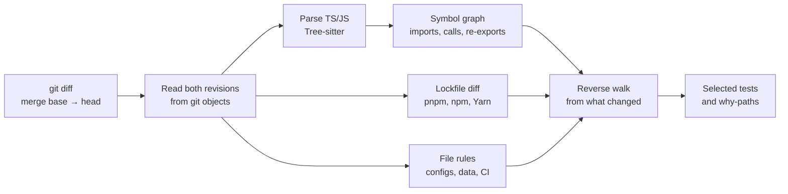

# depwave

**Run the tests your change can actually reach, and see why each one was selected.**

depwave is a test-impact analyzer for JavaScript and TypeScript monorepos. It reads a git diff, builds a symbol-level
dependency graph of both revisions, and selects the test files that can observe the change: through imports and barrel
files, across workspace packages, and through lockfile updates. When it can't prove that a test is unaffected, it
selects the test.

[](https://github.com/zoharyehia-sys/depwave/actions/workflows/ci.yml)


[Quick start](#quick-start) · [How it works](#how-it-works) · [Correctness](#correctness-and-safety) ·
[Results](#results-on-real-repositories) · [CLI](#cli-reference) · [GitHub Actions](#github-actions) ·
[Architecture](ARCHITECTURE.md)

> [!NOTE]
> **Pre-release.** depwave is not published to npm. Run it from a clone, or in GitHub Actions through this
> repository's action, which builds it from source. Commands and output formats may still change.

## Why depwave

Monorepo CI usually runs every test on every pull request, because working out what a change can break is hard. The
usual shortcuts give up either safety or precision. Say a pull request changes one function in
`packages/utils/src/money.ts`:

| Approach | What runs | Trade-off |
|---|---|---|
| Run everything | Every test in the repository | Safe, but CI time grows with the repository, not the change |
| Match file names | `money.test.ts` | Misses every test that reaches `money.ts` through other code |
| Package-level "affected" (`nx affected`, `turbo run test --filter=...[origin/main]`) | Every test in `utils` and in every package that depends on it | Safe, but a small change to a shared package still runs most of the suite |
| **depwave** | The tests that reach the changed **function**, through any number of files, barrels and packages | Runs extra tests whenever a dependency isn't statically visible |

depwave follows code, not file names: a test is selected because a chain of imports, calls and references connects it
to what changed, and `depwave why` prints that chain.

## See it work

Real output from a six-test pnpm monorepo that [`scripts/demo/make-demo.mjs`](scripts/demo/make-demo.mjs) generates,
similar to the checked-in [`pnpm-basic`](fixtures/pnpm-basic) fixture. `@acme/app` uses `@acme/ui`, which uses
`@acme/utils`, and every import goes through a package's `src/index.ts` barrel. The branch changes one function:

```diff
 // packages/utils/src/money.ts
 export function formatCurrency(cents: number): string {
-  return `$${(cents / 100).toFixed(2)}`;
+  return `$${Math.round(cents / 100)}`;
 }
```

```console
$ depwave impact --base main
depwave impact 5f2bcea9454b...d3be4df2fe01 (symbol level)
  changed files:  1
  impacted nodes: 15
  impacted tests: 3

@acme/app (vitest): 1 test file(s)
  packages/app/src/checkout.test.ts
@acme/ui (vitest): 1 test file(s)
  packages/ui/src/PriceTag.test.ts
@acme/utils (vitest): 1 test file(s)
  packages/utils/src/money.test.ts
```

The other three tests (`dates.test.ts`, `DateLabel.test.ts`, `profile.test.ts`) import the same barrels, but nothing
they run reaches `formatCurrency`. Ask depwave about either kind:

```console
$ depwave why packages/app/src/checkout.test.ts --base main
✔ packages/app/src/checkout.test.ts is impacted (symbol level, 5f2bcea9454b...d3be4df2fe01)

    packages/app/src/checkout.test.ts
      → runs its top-level code                 packages/app/src/checkout.test.ts
      → which calls renderCheckout              packages/app/src/checkout.ts:3
      → which calls PriceTag                    packages/ui/src/PriceTag.ts:3
      → which calls formatCurrency  ◀ changed   packages/utils/src/money.ts:1

  This is the shortest path; others may exist.

$ depwave why packages/app/src/profile.test.ts --base main
✘ packages/app/src/profile.test.ts is not impacted (symbol level, 5f2bcea9454b...d3be4df2fe01).
  Nothing it depends on is among the 1 changed file(s).
```

The same diff under three strategies:

| Strategy | Test files selected |
|---|---|
| Package-level: all three packages depend on `@acme/utils` | 6 of 6 |
| `depwave impact --granularity file` (file-level import graph) | 5 of 6 |
| `depwave impact` (symbol level, the default) | **3 of 6** |

**Try it.** From a [built](#quick-start) depwave clone, generate the demo next to it, with the `round-prices` branch
checked out, and run any command above inside it:

```bash
node scripts/demo/make-demo.mjs ../acme-demo
cd ../acme-demo
depwave impact --base main
```

Its commit dates are pinned, so you get the same SHAs as shown here. It also writes `results.json`, the full test run
that the [shadow mode](#shadow-mode) example reads.

## Quick start

**Requirements**
- Node.js 22 or later, and `git` on your `PATH`.
- A clone with enough history to contain the merge base of the two revisions you compare. In CI, check out with
  `fetch-depth: 0`.
- Building from source uses pnpm 9 through Corepack, which ships with Node.js.

**Build it**

```bash
git clone https://github.com/zoharyehia-sys/depwave.git
cd depwave
corepack enable
pnpm install --frozen-lockfile
pnpm build
```

**Run it** from the root of any git repository, or pass `--cwd <dir>`:

```bash
node /path/to/depwave/packages/cli/dist/bin.js impact --base origin/main
```

The examples in this README call it `depwave`. To do the same, add an alias:

```bash
alias depwave="node /path/to/depwave/packages/cli/dist/bin.js"
```

```bash
depwave impact --base origin/main                   # what does this branch affect?
depwave impact --base origin/main --head WORKTREE   # include uncommitted and untracked changes
depwave why packages/app/src/checkout.test.ts       # why is this test selected (or not)?
```

depwave writes nothing to your repository except its cache in `.depwave/`, which contains its own `.gitignore`.

To run it in CI, see [GitHub Actions](#github-actions). To find out whether you can trust its selections, see
[shadow mode](#shadow-mode).

## How it works



1. **Read.** depwave finds the merge base of `--base` and `--head` and reads both trees straight from git objects.
   Nothing is checked out. `--head WORKTREE` adds uncommitted and untracked files.
2. **Discover packages** from `pnpm-workspace.yaml`, the `workspaces` field of `package.json` (npm and Yarn), or Nx
   `project.json` files. A repository without workspaces counts as a single package.
3. **Parse** `.ts`, `.tsx`, `.mts`, `.cts`, `.js`, `.jsx`, `.mjs` and `.cjs` files with Tree-sitter (WebAssembly, so
   no native build). Parsing extracts imports, exports, top-level symbols, and the calls and references between them.
   Test files are `*.test.*` and `*.spec.*` files with a JS or TS extension, plus every file under `__tests__/`.
4. **Resolve** every import with depwave's own resolver, against the revision being analyzed. It handles relative
   paths, tsconfig `paths` and `baseUrl`, `package.json` `#imports`, and workspace packages. Imports of third-party
   packages are recorded but not followed; [lockfile analysis](#lockfile-support) covers those.
5. **Link** imports through barrel files to the symbol that defines them. Importing `formatDate` from a barrel doesn't
   make a file depend on `formatCurrency`.
6. **Seed.** A symbol counts as changed when its body hash or export status differs between the two revisions.
   Comment-only and whitespace-only edits, and code that only moved, change nothing. Non-code files and lockfiles go
   through the [rules below](#what-selects-which-tests).
7. **Walk** backwards from the seeds over the union of both graphs, so deleted code still reaches its old dependents.
   Every test file reached is selected. The shortest path to each one is kept for `depwave why`.

**Two kinds of dependencies.** *Source dependencies* are what your code imports, and they form the graph. *Package
dependencies* are what your workspace packages resolve to in the lockfile. depwave doesn't analyze third-party code.
It works out which packages' resolved dependency trees changed, and selects their tests.

### What selects which tests

Code changes follow the graph. Changes that no import can express follow these rules:

| Change | Selects |
|---|---|
| `pnpm-lock.yaml`, `package-lock.json`, `npm-shrinkwrap.json`, Yarn Berry `yarn.lock` | The packages whose resolved dependencies changed, and their dependents ([details](#lockfile-support)) |
| Yarn classic and Bun lockfiles, the root `package.json`, workspace config (`pnpm-workspace.yaml`, `nx.json`, `turbo.json`, `lerna.json`), `depwave.config.json` | Every test |
| CI definitions (`.github/workflows/`, `.gitlab-ci.yml`, …) and toolchain files (`.nvmrc`, `.node-version`, `.tool-versions`, `.npmrc`, `.yarnrc.yml`, …) | Every test: they change the environment tests run in |
| `tsconfig*.json`, `jsconfig*.json`, Vite/Vitest/Jest config, Babel config | Everything under its directory |
| A workspace package's `package.json` | That package and every package that depends on it |
| A file no code imports (JSON fixtures, templates, images) | The tests of its package, plus every test that imports one of that package's test helpers |
| `__snapshots__/x.test.ts.snap` | Exactly `x.test.ts` |
| Docs and editor config (`*.md`, `LICENSE`, `.vscode/`, …) outside test-data directories | Nothing |

### Cache

depwave caches parsed files by content hash and whole commit graphs by commit SHA, in an SQLite file at
`.depwave/cache.db`. Both keys are immutable, so entries can't go stale, and upgrading depwave invalidates them. The
cache never changes an answer. If it fails (a corrupt file, a full disk, a missing native binary), the run continues
uncached with a warning. Use `--no-cache` to bypass it, `depwave cache stats` to inspect it, and `depwave cache clear`
to empty it. [ARCHITECTURE.md §4](ARCHITECTURE.md#4-incremental-graph-caching--algorithmic-strategy) has the design.

## Lockfile support

Dependency updates from Renovate or Dependabot usually touch only a lockfile and a manifest. Instead of treating that as
"run everything", depwave diffs the lockfile and selects the workspace packages whose **resolved dependency tree**
changed, even when the change is deep in the tree (`debug` moving to a new `ms` selects whoever uses `debug`). It then
adds the packages that depend on them.

| | pnpm | npm | Yarn Berry |
|---|---|---|---|
| Files | `pnpm-lock.yaml` | `package-lock.json`, `npm-shrinkwrap.json` | `yarn.lock` |
| Formats | Lockfile v6 and v9, including pnpm 11+ multi-document lockfiles | `lockfileVersion` 2 and 3 | Yarn 2+ lockfiles (with `__metadata`) |
| How dependencies resolve | pnpm's resolved graph, per importer | Node-style lookup through nested `node_modules` | Descriptor to resolution |
| Layout | Isolated | Hoisted | Plug'n'Play, or hoisted with `nodeLinker: node-modules` or `pnpMode: loose` |

All three formats go through one model. A workspace package is affected when its own lockfile entry changed, or when
it can reach a changed package entry at head. Any field counts, so a change to the integrity hash alone still selects
the package. Lockfiles count only at the repository root or at a package root. Elsewhere (in a fixture, say) they are
treated as data files.

Here is a real `effect` upgrade in tRPC, commit `dce10f3`. It selected 79 of 207 test files:

```console
$ depwave impact --base dce10f3~1 --head dce10f3
depwave impact 50543c8d417a...dce10f33777d (symbol level)
  changed files:  3
  impacted nodes: 573
  impacted tests: 79
  trigger:        packages/tests/package.json (package-manifest)
  trigger:        pnpm-lock.yaml (lockfile, 2 packages: effect 3.21.0 → 3.22.2)
  trigger:        www/package.json (package-manifest)
  ⚠ unresolved imports: 1 (see --format json)
```

**Hoisted layouts** (npm, and Yarn with `nodeLinker: node-modules` or `pnpMode: loose`) put dependencies in the root
`node_modules`. There, code can import a package its manifest never declared, and it works. So depwave records each
file's third-party imports, and also selects packages whose code imports a changed package, or a package that depends
on one. pnpm's isolated layout and Yarn Plug'n'Play reject undeclared imports, so declared dependencies are enough
there.

**depwave selects every test, and names the reason**, when a lockfile change isn't confined to packages:

- The root importer's dependencies changed. The root `node_modules` is on every package's lookup path.
- A changed package matches `*eslint*` or `*prettier*` (pnpm's default public-hoist patterns), or a
  `public-hoist-pattern` you configured. Tools like these load plugins by name from the root.
- Everything is hoisted: pnpm's `shamefully-hoist=true` or `node-linker=hoisted`.
- The package manager changed (the env document of pnpm 11+ lockfiles), or a global section changed: pnpm `settings`,
  `overrides` and `patchedDependencies`, npm's top-level fields, or Yarn's `__metadata`.
- The lockfile's format version changed, or the lockfile was added, deleted or can't be parsed.
- The format isn't analyzed: Yarn classic (v1), Bun (`bun.lock`, `bun.lockb`), npm `lockfileVersion` 1, or a pnpm
  lockfile without `importers`.

## Correctness and safety

A missed failing test costs far more than an extra passing one: it lets a regression through and destroys trust in the
tool. So depwave is built to over-select. Precision features may only remove tests that are provably unaffected, and
anything depwave can't see widens the selection ([ADR 0004](docs/adr/0004-soundness-over-precision.md)). Every
scenario in [`fixtures/`](fixtures) runs end to end at both granularities, and the expected results require the
symbol level to select a subset of what the file level selects.

### Widened on purpose

| Situation | What depwave assumes |
|---|---|
| `import(expr)` with a non-literal argument | The importer may load any file in its package |
| `import.meta.glob('./x/*.ts')`, `require.context(…)`, `` import(`./x/${name}.ts`) `` | Every file the pattern matches |
| Namespace imports (`import * as x`), CommonJS `require` | A dependency on every export of the target |
| Type-only imports | Followed: a changed type can break a test's compile step |
| Using a class | A dependency on every member of the class. Per-member tracking was [measured and rejected](docs/adr/0006-symbol-level-model.md): method calls through interface-typed values can't be bound without type information |
| A test that spawns processes (`child_process`, `execa`, …) | It may run any file in its package |
| A source file depwave fails to extract | It may depend on anything in its package |

`depwave why` marks the steps it can't prove statically (glob and `import(expr)` edges) with `~`.

### What depwave can't see

These can cause a missed test. Know them before you skip tests based on depwave's output:

- **Unresolved imports.** An import depwave can't resolve adds no edge, and it doesn't widen the selection. It is
  reported: `⚠ unresolved imports: N` in text output, and `report.unresolved` in JSON. Treat a non-empty list as a
  reason not to trust that run's selection. This repository's CI fails its self-check when the list isn't empty.
- **Runtime wiring.** Dependency-injection containers, string-based plugin loading, reflection, and framework
  conventions such as file-system routing. Apart from the `*eslint*` and `*prettier*` rule, depwave doesn't detect a
  package loaded by name.
- **Files read across packages.** A test that reads another package's files by path, without importing anything from
  that package.
- **Other languages.** Only TypeScript and JavaScript are parsed. Other files are treated as data files.
- **Test naming.** A test file outside `__tests__/` that isn't named `*.test.*` or `*.spec.*` (JS or TS) is never
  selected. [Shadow mode](#shadow-mode) lists such files as unrecognized.

### Shadow mode

Running only the selected tests is a bet that depwave saw every dependency. Shadow mode checks that bet on your real
CI: **keep running every test**, and let depwave compare each failure with what it would have selected.

```bash
npx vitest run --reporter=default --reporter=json --outputFile.json=test-results.json
depwave shadow --base origin/main --results test-results.json
```

```console
$ depwave shadow --base main --results results.json
depwave shadow 5f2bcea9454b...d3be4df2fe01: 1 failing test file NOT selected ✘
  a selective run would have run 3 of 6 test files (50% skipped)
  missed: packages/app/src/profile.test.ts
  Each one is either a flaky test or a dependency depwave did not see. Run `depwave why <test>` to check, and please report the second kind.
```

| Verdict | Meaning | Exit code |
|---|---|---|
| `sound` | Every failing test file was selected, or nothing failed | 0 |
| `missed` | A failing test file was **not** selected: a flaky test, or a dependency depwave didn't see | **3** |
| `inconclusive` | Nothing was missed, but some failures can't be traced to a file (JUnit without file paths) | 0 |

- It reads Vitest and Jest JSON (`--reporter=json`, `jest --json`) and JUnit XML, detected from the content. Repeat
  `--results` for several runners. Relative paths in the results are resolved from the repository root; use
  `--results-root` to change that.
- **Only failures carry information.** A green build tells you how much a selective run would have saved, but nothing
  about whether depwave would have caught a regression. Judge depwave on builds where tests actually failed.
- This repository runs shadow mode on every CI build and uploads `depwave-shadow.json` as a record. Its first run found
  a real miss: a test importing `post-comment.mjs` was linked to the `.d.mts` type stub next to it, instead of the
  JavaScript that runs. The resolver now follows a declaration file to its runtime sibling.

### Rolling it out

1. **Observe.** Add depwave to your existing full test job with
   [`test-results`](#shadow-mode-in-github-actions). Nothing about what runs changes.
2. **Investigate every `missed`** with `depwave why`. A dependency depwave didn't see is a bug worth reporting.
3. **Switch pull requests to selective runs** only after a stretch of `sound` verdicts on builds that really failed.
4. **Keep a full run** after merge to `main`, or nightly, to catch whatever a selective run skips.

## Results on real repositories

Lockfile narrowing, replayed on four open-source monorepos. For each commit that touched the root lockfile, depwave
compared the commit with its parent. The baseline runs every test file on every one of those commits.

| Repository | Lockfile | Commits | Narrowed | Test-file runs (baseline) | Skipped |
|---|---|---|---|---|---|
| [tRPC](https://github.com/trpc/trpc) | pnpm | 9 | 7 | 1,871 | **1,154 (62%)** |
| [Vite](https://github.com/vitejs/vite) | pnpm | 11 | 4 | 4,716 | **1,513 (32%)** |
| [Jest](https://github.com/jestjs/jest) | Yarn Berry, hoisted | 24 | 5 | 29,398 | **2,941 (10%)** |
| [Playwright](https://github.com/microsoft/playwright) | npm | 7 | 0 | 4,103 | 0 (0%) |

"Narrowed" counts the commits that didn't select every test. Every other commit had a reason to run everything, and
depwave named it:

- **tRPC (2):** a `patchedDependencies` change, and a commit that also changed `pnpm-workspace.yaml`.
- **Vite (7):** pnpm itself was upgraded (2), root dependencies changed (2), `overrides` changed, a hoisted
  `*eslint*` plugin changed, and a commit also changed `pnpm-workspace.yaml`.
- **Jest (19):** a hoisted `*eslint*` package changed (9), root dependencies changed (8), and another global trigger
  fired in the same commit (2).
- **Playwright (7):** root dependencies changed every time. Playwright keeps its tooling in the root `package.json`.

**How to read this**
- It measures **lockfile commits only**, not the everyday code changes depwave mostly sees.
- It counts **test files, not CI minutes**. Wall-clock savings depend on how long each test runs and on per-job
  overhead.
- It measures **selection size, not correctness**: no test suites ran. Correctness rests on the rules above, and on
  shadow mode in your own CI.

**Setup.** Measured on 2026-10-28 with depwave [`ad89e7c`](https://github.com/zoharyehia-sys/depwave/commit/ad89e7c),
Node.js 22.14 on Windows 11. Shallow clones at these commits: tRPC
[`e237729`](https://github.com/trpc/trpc/commit/e237729d3ca2f4bb34e6084424e62d12f70380d3) and Vite
[`cce559a`](https://github.com/vitejs/vite/commit/cce559ab158cc6b177d0911a0bea73436b48faff) (last 60 commits), Jest
[`61050e9`](https://github.com/jestjs/jest/commit/61050e9323e742539dc2360236671110e37329e6) and Playwright
[`1b9b602`](https://github.com/microsoft/playwright/commit/1b9b602724484df3ebc41aba77824fdfaba861f6) (last 120
commits). A lockfile commit whose parent falls outside the clone is left out.

**Reproduce it.** From a [built](#quick-start) depwave clone, [`scripts/bench/run.mjs`](scripts/bench/run.mjs) fetches
each repository at the commit above and prints this table. It needs network access to GitHub, and reuses the clones on
later runs:

```bash
node scripts/bench/run.mjs ../depwave-bench              # all four
node scripts/bench/run.mjs ../depwave-bench trpc vite    # or some of them
```

depwave reads git objects only, so the clones are never checked out (Vite's paths are too long to check out on
Windows). For any other repository, run
[`scripts/bench/lockfile-replay.mjs`](scripts/bench/lockfile-replay.mjs) on a clone of it:

```bash
node scripts/bench/lockfile-replay.mjs /path/to/repo pnpm-lock.yaml
```

It runs `depwave impact <sha>~1..<sha> --format json` for each commit that touched the lockfile and prints one line per
commit (`✔` narrowed, `■` ran everything), then a `SUMMARY` line with the totals. The baseline is `plan.totalTests`,
the selection is `plan.groups[].tests`, and when `plan.runAll` is `true` every test is selected.

## CLI reference

| Command | What it does |
|---|---|
| `depwave impact` | Lists the test files a diff impacts, grouped by package |
| `depwave why <file>` | Shows the shortest dependency chain from a change to `<file>`, or says it isn't impacted |
| `depwave shadow --results <file>` | Checks a full test run's failures against what depwave would have selected |
| `depwave cache stats` | Shows what the cache holds, and its size |
| `depwave cache clear` | Empties the cache |

| Option | Default | Applies to | Meaning |
|---|---|---|---|
| `--base <rev>` | `origin/main` | `impact`, `why`, `shadow` | Revision to compare against. The merge base with `--head` is used, so commits that landed on the base branch after you branched don't count |
| `--head <rev>` | `HEAD` | `impact`, `why`, `shadow` | Revision to analyze. `WORKTREE` adds uncommitted and untracked changes |
| `--format <f>` | `text` | `impact`, `why`, `shadow` | `text` or `json`. `impact` and `shadow` also accept `markdown`, which is used for PR comments |
| `--granularity <g>` | `symbol` | `impact`, `why`, `shadow` | `symbol` follows functions, classes and variables. `file` follows whole files |
| `--explain <n>` | `3` | `impact` | With `--format markdown`, includes `depwave why` paths for the top `n` tests (`0` for none) |
| `--results <file>` | required | `shadow` | Vitest/Jest JSON or JUnit XML. Repeatable |
| `--results-root <dir>` | repository root | `shadow` | Directory that relative paths in the results are resolved from |
| `--cwd <dir>` | current directory | all | Repository to analyze |
| `--no-cache` | cache on | `impact`, `why`, `shadow` | Skips the `.depwave/` cache |

| Exit code | Meaning |
|---|---|
| `0` | Success. This includes `why` reporting that a file isn't impacted, and a `sound` or `inconclusive` shadow verdict |
| `1` | Failure, with a one-line message on stderr: not a git repository, an unknown revision, an invalid manifest or config, an invalid option, a path `why` doesn't know, or a results file without tests |
| `3` | `shadow`: a failing test file was not selected |

`--format json` prints `{ "report": …, "plan": … }`. `plan` holds `runAll`, `totalTests`, and `groups` of
`{ packageName, runner, tests }`. `report` holds the changed files, seeds, global triggers, every impacted node, and
unresolved imports. The schema isn't stable yet.

## GitHub Actions

This repository is also a composite action. It builds depwave, analyzes the pull request, writes the report to the job
summary, and posts or updates one comment on the PR. On this repository the whole step takes about 20 seconds,
including the build.

```yaml
# .github/workflows/tests.yml
on: pull_request
permissions:
  contents: read
  pull-requests: write # for the PR comment
jobs:
  test:
    runs-on: ubuntu-latest
    steps:
      - uses: actions/checkout@v4
        with:
          fetch-depth: 0 # depwave needs the merge base
      - uses: zoharyehia-sys/depwave@main # no releases yet: pin a commit SHA for stability
        id: depwave
      # … set up Node.js and install your dependencies here …
      - name: Run all tests
        if: steps.depwave.outputs.run-all == 'true'
        run: npx vitest run
      - name: Run impacted tests
        if: steps.depwave.outputs.run-all != 'true' && steps.depwave.outputs.impacted-tests != '0'
        env:
          TESTS: ${{ steps.depwave.outputs.tests }} # pass PR-controlled paths through env, never inline in run:
        run: npx vitest run $TESTS
```

For Jest, use `npx jest --runTestsByPath $TESTS`.

- The comment shows the headline (*"3 test files impacted of 6 (50% skipped)"*), the tests per package, global
  triggers, unresolved imports, and `depwave why` paths for the top tests.
- On pull requests from forks the token is read-only, so the comment is skipped with a warning. The job summary still
  has the report.
- The action sets up Node.js 22 with `actions/setup-node`. If your tests need another version, set it up after the
  depwave step.

| Input | Default | Meaning |
|---|---|---|
| `base` | `origin/<PR base branch>` | Revision to compare against (its merge base is used) |
| `granularity` | `symbol` | `symbol` or `file` |
| `explain` | `3` | `depwave why` paths for the top N tests in the comment (`0` for none) |
| `comment` | `true` | Post or update the sticky PR comment |
| `test-results` | | Shadow mode: results of a full test run (paths separated by spaces or newlines) |
| `github-token` | `github.token` | Token for the comment. Needs `pull-requests: write` |

| Output | Meaning |
|---|---|
| `impacted-tests` | Number of impacted test files |
| `total-tests` | Number of test files at head |
| `run-all` | `true` when a global trigger selected every test |
| `tests` | Impacted test files, separated by spaces |
| `report` | Path to the full JSON report |
| `shadow-verdict` | With `test-results`: `sound`, `missed` or `inconclusive` |
| `shadow-missed` | With `test-results`: failing test files depwave didn't select |

### Shadow mode in GitHub Actions

Run the action **after** a full test run, and pass it the results. The verdict is added to the PR comment, and when a
failing test was missed the job fails, after the comment is posted.

```yaml
      - name: Run all tests
        run: npx vitest run --reporter=default --reporter=json --outputFile.json=test-results.json
      - uses: zoharyehia-sys/depwave@main
        if: ${{ !cancelled() }} # failing runs are the interesting ones
        with:
          test-results: test-results.json
```

There is no packaged integration for other CI systems yet. Use the CLI directly: `--format json` for scripts, and
`--format markdown` for a PR comment.

## Configuration

`depwave.config.json` is optional, and lives at the repository root. It's read from git at each analyzed revision, so
the base and the head of a diff can each have their own.

```json
{ "ignore": ["fixtures/**", "**/*.generated.ts"] }
```

| Key | Type | Default | Meaning |
|---|---|---|---|
| `ignore` | `string[]` (repo-relative globs) | `[]` | Paths that aren't part of the code under analysis: fixtures, examples, vendored or generated code. Ignored paths define no packages, add no files to the graph, and never match dynamic-import globs |

Unknown keys are ignored, and a malformed file fails the run. Changing this file selects every test.

## Compatibility

| Area | Supported | Not supported |
|---|---|---|
| Languages | TypeScript, TSX, JavaScript, JSX (ESM and CommonJS) | Everything else, which is treated as data files |
| Workspaces | pnpm, npm and Yarn workspaces, Nx `project.json`, single-package repositories | |
| Lockfiles | pnpm v6 and v9, npm v2 and v3, Yarn Berry | Yarn classic, Bun, npm v1: every test is selected |
| Test runners | Any runner that accepts file paths. Shadow mode reads Vitest/Jest JSON and JUnit XML | |
| Runtime | Node.js 22+ with git. CI runs on Ubuntu and Windows, including a checkout path with spaces and non-ASCII characters | macOS isn't tested in CI |
| CI | GitHub Actions (composite action), any CI through the CLI | |

Planned but not built yet: dependency-graph export, cycle detection, type-aware method binding, and plugins for
framework conventions. See the roadmap in [ARCHITECTURE.md §5](ARCHITECTURE.md#5-implementation-roadmap).

## Development

```bash
corepack enable
pnpm install
pnpm check
```

`pnpm check` runs the typecheck, the dependency layering rules, the tests and the build. They also run separately:
`pnpm typecheck`, `pnpm lint:deps`, `pnpm test` and `pnpm build`. Tests run against the sources (Vitest aliases
`@depwave/*` to `packages/*/src`), so no build is needed first.

| Package | Role |
|---|---|
| `@depwave/core` | Domain model, ports and algorithms: graph, diff analysis, impact walk, test selection. No I/O |
| `@depwave/parser` | Tree-sitter extraction of imports, exports, symbols and references |
| `@depwave/resolver` | Module resolution over a git revision |
| `@depwave/workspace` | Workspace discovery, source inventory, lockfile analysis |
| `@depwave/git` | Git access through the `git` CLI |
| `@depwave/cache` | The SQLite cache |
| `@depwave/reporters` | Text, JSON and Markdown reports |
| `@depwave/cli` | Commands, and the composition root |

`dependency-cruiser` enforces the layering: `core` imports nothing, adapters import only `core`, and `cli` may import
anything.

**Further reading**
- [ARCHITECTURE.md](ARCHITECTURE.md): the data model, algorithms and caching design.
- [docs/adr](docs/adr): the decisions behind the parser, the cache, the graph, soundness and the symbol model.
- [fixtures](fixtures/README.md): example monorepos with expected impact, which serve as the spec.

Bug reports are most useful with `depwave why` output, or the shadow-mode verdict that exposed the miss.
