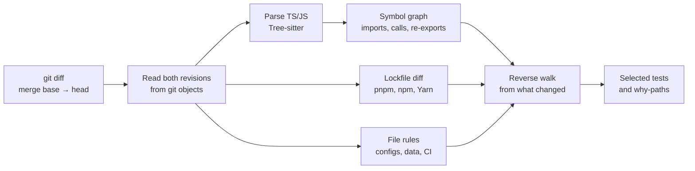

# depwave

**Run the tests your change can actually reach, and see why each one was selected.**

depwave is a test-impact analyzer for JavaScript and TypeScript monorepos. It reads a git diff, builds a symbol-level
dependency graph of both revisions, and selects the test files that can observe the change: through imports and barrel
files, across workspace packages, and through lockfile updates. When it can't prove that a test is unaffected, it
selects the test.

[](https://github.com/zoharyehia-sys/depwave/actions/workflows/ci.yml)

[](LICENSE)

[Quick start](#quick-start) · [Why depwave](#why-depwave) · [How it works](#how-it-works) ·
[Safety](#correctness-and-safety) · [Results](#results-on-real-repositories) · [CI](#github-actions) ·
[Docs](#documentation)

## Quick start

You need Node.js 22 or later, `git`, and a clone whose history contains the merge base of the revisions you compare.
depwave isn't published to npm yet, so you build it from source.

**1. Install**

```bash
git clone https://github.com/zoharyehia-sys/depwave.git
cd depwave
corepack enable          # provides the pinned pnpm 9
pnpm install --frozen-lockfile
pnpm build
alias depwave="node '$PWD/packages/cli/dist/bin.js'"
```

**2. Analyze a diff.** From the root of any git repository:

```bash
depwave impact --base origin/main
```

Here it is on a six-test demo monorepo where one shared function changed. You can create the same repository with
`node scripts/demo/make-demo.mjs`.

```console
$ depwave impact --base main
depwave impact 2f61664a3bd4...d0d3fed2d141 (symbol level)
  changed files:  1
  impacted nodes: 15
  impacted tests: 3

@acme/app (vitest): 1 test file(s)
  packages/app/src/checkout.test.ts
@acme/ui (vitest): 1 test file(s)
  packages/ui/src/PriceTag.test.ts
@acme/utils (vitest): 1 test file(s)
  packages/utils/src/money.test.ts
```

**3. Ask why** a test was selected, or wasn't:

```console
$ depwave why packages/app/src/checkout.test.ts --base main
✔ packages/app/src/checkout.test.ts is impacted (symbol level, 2f61664a3bd4...d0d3fed2d141)

    packages/app/src/checkout.test.ts
      → runs its top-level code                 packages/app/src/checkout.test.ts
      → which calls renderCheckout              packages/app/src/checkout.ts:3
      → which calls PriceTag                    packages/ui/src/PriceTag.ts:3
      → which calls formatCurrency  ◀ changed   packages/utils/src/money.ts:1

  This is the shortest path; others may exist.

$ depwave why packages/app/src/profile.test.ts --base main
✘ packages/app/src/profile.test.ts is not impacted (symbol level, 2f61664a3bd4...d0d3fed2d141).
  Nothing it depends on is among the 1 changed file(s).
```

Add `--head WORKTREE` to include uncommitted and untracked changes. depwave writes nothing to your repository except
its cache in `.depwave/`, which contains its own `.gitignore`.

**Next:** run it in [CI](#github-actions), and check it against your full test runs with
[shadow mode](#shadow-mode) before you skip anything. Every command and option is in the
[CLI reference](docs/cli.md).

## Why depwave

Monorepo CI usually runs every test on every pull request, because working out what a change can break is hard. The
usual shortcuts give up either safety or precision. In the demo above, the change was one function in
`@acme/utils`, which the other two packages depend on:

| Approach | What runs | Demo |
|---|---|---|
| Run everything | Every test in the repository | 6 of 6 |
| Package-level "affected" (`nx affected`, `turbo run test --filter=...[origin/main]`) | Every test in the changed package and in every package that depends on it | 6 of 6 |
| File-level import graph (`depwave impact --granularity file`) | Tests that import the changed file, directly or through other files | 5 of 6 |
| **depwave** (symbol level, the default) | Tests that reach the changed **function**, through any number of files, barrels and packages | **3 of 6** |
| Match file names | `money.test.ts` | 1 of 6, missing two tests that can fail |

The other three demo tests import the same package barrels, but nothing they run reaches `formatCurrency`.

## How it works



1. **Read** both revisions straight from git objects, from the merge base of `--base` and `--head`. Nothing is checked
   out.
2. **Discover packages** from `pnpm-workspace.yaml`, the `workspaces` field of `package.json` (npm and Yarn), or Nx
   `project.json` files. A repository without workspaces counts as a single package.
3. **Parse and resolve** every `.ts`, `.tsx`, `.mts`, `.cts`, `.js`, `.jsx`, `.mjs` and `.cjs` file with Tree-sitter and
   depwave's own resolver. That covers relative paths, tsconfig `paths` and `baseUrl`, `#imports`, and workspace
   packages. Imports are bound through barrel files to the symbol that defines them.
4. **Seed** from what changed. A symbol counts as changed when its body hash or export status differs, so comment-only
   and whitespace-only edits change nothing. Files that no import expresses, such as configs, data files, CI
   definitions and lockfiles, go through [rules](#changes-no-import-can-express).
5. **Walk** backwards over the union of both graphs, so deleted code still reaches its old dependents. Every test file
   reached is selected (`*.test.*` and `*.spec.*` with a JS or TS extension, and every file under `__tests__/`). The
   shortest path to each one is kept for `depwave why`.

**Two kinds of dependencies.** *Source dependencies* are what your code imports, and they form the graph. *Package
dependencies* are what your workspace packages resolve to in the lockfile. depwave doesn't analyze third-party code.
It diffs the lockfile (pnpm, npm or Yarn Berry), works out which packages' resolved dependency trees changed, and
selects their tests. With npm's hoisted layout, it also selects packages that import a changed dependency without
declaring it. Details: [lockfile changes](docs/lockfiles.md).

## Correctness and safety

A missed failing test costs far more than an extra passing one: it lets a regression through and destroys trust in the
tool. So depwave is built to over-select. Precision features may only remove tests that are provably unaffected, and
anything depwave can't see widens the selection ([ADR 0004](docs/adr/0004-soundness-over-precision.md)). Every
scenario in [`fixtures/`](fixtures) runs end to end at both granularities, and the expected results require the
symbol level to select a subset of what the file level selects.

### Widened on purpose

| Situation | What depwave assumes |
|---|---|
| `import(expr)` with a non-literal argument | The importer may load any file in its package |
| `import.meta.glob('./x/*.ts')`, `require.context(…)`, `` import(`./x/${name}.ts`) `` | Every file the pattern matches |
| Namespace imports (`import * as x`), CommonJS `require` | A dependency on every export of the target |
| Type-only imports | Followed: a changed type can break a test's compile step |
| Using a class | A dependency on every member of the class. Per-member tracking was [measured and rejected](docs/adr/0006-symbol-level-model.md): method calls through interface-typed values can't be bound without type information |
| A test that spawns processes (`child_process`, `execa`, …) | It may run any file in its package |
| A source file depwave fails to extract | It may depend on anything in its package |

`depwave why` marks the steps it can't prove statically (glob and `import(expr)` edges) with `~`.

### Changes no import can express

| Change | Selects |
|---|---|
| A lockfile (pnpm, npm, Yarn Berry) | The packages whose resolved dependencies changed, and their dependents. Every test when the change reaches the root or isn't confined to packages ([details](docs/lockfiles.md#when-every-test-is-selected)) |
| Yarn classic and Bun lockfiles, the root `package.json`, workspace config (`pnpm-workspace.yaml`, `nx.json`, `turbo.json`, `lerna.json`), `depwave.config.json` | Every test |
| CI definitions (`.github/workflows/`, `.gitlab-ci.yml`, …) and toolchain files (`.nvmrc`, `.node-version`, `.tool-versions`, `.npmrc`, `.yarnrc.yml`, …) | Every test: they change the environment tests run in |
| `tsconfig*.json`, `jsconfig*.json`, Vite/Vitest/Jest config, Babel config | Everything under its directory |
| A workspace package's `package.json` | That package and every package that depends on it |
| A file no code imports (JSON fixtures, templates, images) | The tests of its package, plus every test that imports one of that package's test helpers |
| `__snapshots__/x.test.ts.snap` | Exactly `x.test.ts` |
| Docs and editor config (`*.md`, `LICENSE`, `.vscode/`, …) outside test-data directories | Nothing |

### What depwave can't see

These can cause a missed test. Know them before you skip tests based on depwave's output:

- **Unresolved imports.** An import depwave can't resolve adds no edge, and it doesn't widen the selection. It is
  reported: `⚠ unresolved imports: N` in text output, and `report.unresolved` in JSON. Treat a non-empty list as a
  reason not to trust that run's selection. This repository's CI fails its self-check when the list isn't empty.
- **Runtime wiring.** Dependency-injection containers, string-based plugin loading, reflection, and framework
  conventions such as file-system routing. Apart from the `*eslint*` and `*prettier*` lockfile rule, depwave doesn't
  detect a package loaded by name.
- **Files read across packages.** A test that reads another package's files by path, without importing anything from
  that package.
- **Other languages.** Only TypeScript and JavaScript are parsed. Other files are treated as data files.
- **Test naming.** A test file outside `__tests__/` that isn't named `*.test.*` or `*.spec.*` (JS or TS) is never
  selected. [Shadow mode](#shadow-mode) lists such files as unrecognized.

### Shadow mode

Running only the selected tests is a bet that depwave saw every dependency. Shadow mode checks that bet on your real
CI: **keep running every test**, and let depwave compare each failure with what it would have selected.

```bash
npx vitest run --reporter=default --reporter=json --outputFile.json=test-results.json
depwave shadow --base origin/main --results test-results.json
```

On the demo repository, where `make-demo.mjs` also writes the results of a full run in which `profile.test.ts`
failed:

```console
$ depwave shadow --base main --results results.json
depwave shadow 2f61664a3bd4...d0d3fed2d141: 1 failing test file NOT selected ✘
  a selective run would have run 3 of 6 test files (50% skipped)
  missed: packages/app/src/profile.test.ts
  Each one is either a flaky test or a dependency depwave did not see. Run `depwave why <test>` to check, and please report the second kind.
```

| Verdict | What it means | Exit code |
|---|---|---|
| `sound` | **No miss was observed in this run.** Every test file that failed was one depwave selected, or nothing failed | 0 |
| `missed` | A test file that failed was **not** selected: a flaky test, or a dependency depwave didn't see | **3** |
| `inconclusive` | No miss was observed, but some failures can't be traced to a file (JUnit without file paths) | 0 |

> [!IMPORTANT]
> **`sound` is an observation about one run, not a proof.** It says that no failing test fell outside the selection
> this time. It can't say that every test depwave skipped was unaffected: a skipped test that passed would have passed
> either way, so it carries no evidence. When nothing fails, `sound` tells you nothing about depwave's accuracy, only
> how much a selective run would have saved. Confidence comes from many runs where tests actually failed and were all
> selected.

- It reads Vitest and Jest JSON (`--reporter=json`, `jest --json`) and JUnit XML. Repeat `--results` for several
  runners.
- This repository runs shadow mode on every CI build and uploads `depwave-shadow.json` as a record. Its first run found
  a real miss: a test importing `post-comment.mjs` was linked to the `.d.mts` type stub next to it, instead of the
  JavaScript that runs. The resolver now follows a declaration file to its runtime sibling.

### Rolling it out

1. **Observe.** Add depwave to your existing full test job with
   [`test-results`](docs/github-action.md#shadow-mode). Nothing about what runs changes.
2. **Investigate every `missed`** with `depwave why`. A dependency depwave didn't see is a bug worth reporting.
3. **Switch pull requests to selective runs** only after a stretch of builds with real failures, all of them selected.
4. **Keep a full run** after merge to `main`, or nightly, to catch whatever a selective run skips.

## Results on real repositories

The lockfile analysis, replayed on every commit that touched the root lockfile in four open-source monorepos. Each
commit was compared with its parent. The baseline runs every test file on each of those commits.

| Repository | Lockfile | Commits replayed | Test-file runs (baseline) | Skipped |
|---|---|---|---|---|
| tRPC | pnpm | 9 | 1,871 | **1,154 (62%)** |
| Vite | pnpm | 11 | 4,716 | **1,513 (32%)** |
| Jest | Yarn Berry, hoisted | 24 | 29,398 | **2,941 (10%)** |
| Playwright | npm | 7 | 4,103 | 0 (0%) |

- This covers **lockfile commits only**, not the everyday code changes depwave mostly sees.
- It counts **test files, not CI time**. Skipping 62% of test files doesn't save 62% of CI minutes: tests differ in
  duration, and setup, install and build costs stay the same.
- It measures **selection size, not correctness**: no test suites ran.

The [benchmark report](docs/benchmarks.md) has the pinned commits, the exact commands, every replayed commit with its
selection, and why each full run happened. `node scripts/bench/readme-benchmark.mjs` reproduces the table.

## GitHub Actions

This repository is also a composite action. It builds depwave, analyzes the pull request, writes the report to the job
summary, and posts one sticky comment on the PR. If the analysis fails, this workflow runs every test:

```yaml
on: pull_request
permissions:
  contents: read
  pull-requests: write # only for the PR comment
jobs:
  test:
    runs-on: ubuntu-latest
    steps:
      - uses: actions/checkout@v4
        with:
          fetch-depth: 0 # depwave needs the merge base
      - uses: zoharyehia-sys/depwave@ad89e7cbf88996aa4509391b5bab1b88c9535179 # main on 2026-10-28
        id: depwave
        continue-on-error: true # if the analysis fails, run everything below instead of nothing
      # … set up Node.js and install your dependencies here …
      - name: Run all tests
        if: steps.depwave.outcome != 'success' || steps.depwave.outputs.run-all == 'true'
        run: npx vitest run
      - name: Run impacted tests
        if: steps.depwave.outcome == 'success' && steps.depwave.outputs.run-all != 'true' && steps.depwave.outputs.impacted-tests != '0'
        env:
          TESTS: ${{ steps.depwave.outputs.tests }} # PR-controlled paths: pass them through env, never inline in run:
        run: npx vitest run $TESTS
```

There are no releases yet, so pin a full commit SHA rather than a moving branch. This exact workflow runs on every
pull request to this repository. The [Action guide](docs/github-action.md) covers every input and output, what runs
in each case, shadow mode in CI, and other CI systems.

## Compatibility

| Area | Supported | Not supported |
|---|---|---|
| Languages | TypeScript, TSX, JavaScript, JSX (ESM and CommonJS) | Everything else, which is treated as data files |
| Workspaces | pnpm, npm and Yarn workspaces, Nx `project.json`, single-package repositories | |
| Lockfiles | pnpm v6 and v9, npm v2 and v3, Yarn Berry | Yarn classic, Bun, npm v1: every test is selected |
| Test runners | Any runner that accepts file paths. Shadow mode reads Vitest/Jest JSON and JUnit XML | |
| Runtime | Node.js 22+ with git. CI runs on Ubuntu and Windows, including a checkout path with spaces and non-ASCII characters | macOS isn't tested in CI |
| Distribution | Source build, GitHub Action | npm package, release tags |

Beyond test selection, `depwave cycles` lints for import cycles and `depwave graph` draws the dependency graph as
Mermaid or Graphviz ([CLI reference](docs/cli.md)). Planned but not built yet: type-aware method binding, and plugins
for framework conventions. See the [roadmap](ARCHITECTURE.md#5-implementation-roadmap).

## Documentation

| Page | What's in it |
|---|---|
| [CLI reference](docs/cli.md) | Every command, option and exit code, JSON output, configuration, the cache |
| [GitHub Action](docs/github-action.md) | The full workflow, inputs and outputs, failure handling, shadow mode in CI |
| [Lockfile changes](docs/lockfiles.md) | Supported formats, how a change is narrowed, hoisting, when every test runs |
| [Benchmark report](docs/benchmarks.md) | Method, pinned commits, per-commit results, how to reproduce |
| [Architecture](ARCHITECTURE.md) and [ADRs](docs/adr) | The data model, algorithms and caching design, and the decisions behind them |
| [Contributing](CONTRIBUTING.md) | Development setup, project layout, what a change to selection rules needs |

## License

[MIT](LICENSE)
